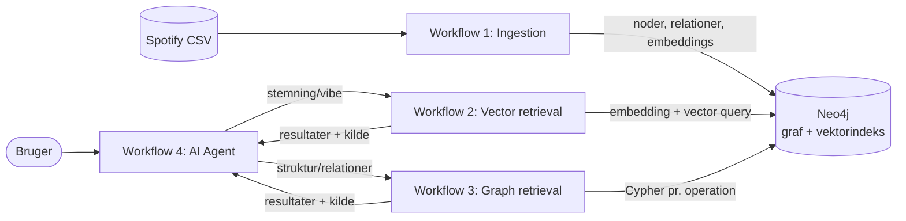

# Spotify-musikguiden: RAG med vektor- og grafsøgning i Neo4j

Et AI-agentprojekt i n8n, hvor en agent besvarer spørgsmål om musik ved at kombinere **semantisk søgning** (vektorindeks) og **graf-traversering** i **samme Neo4j-database**.

## 1. Case og agentens rolle

**Domæne:** Spotify-sange (`high_popularity_spotify_data.csv`, 1437 unikke tracks efter dublet-fjernelse). Musik passer godt til begge teknikker:

- **Vektor (semantisk lighed):** "rolig aftenmusik" er en stemning, ikke et nøgleord. Hver sang beskrives i tekst og embeddes, så brugeren kan søge på vibe.
- **Graf (relationer):** Kunstner, album, genre, undergenre og år er strukturerede forbindelser. Spørgsmål som "hvilke genrer spiller X?" eller "hvem ligner X?" besvares ved at følge relationer.

**Agentens rolle:** "Spotify-musikguiden", en dansk musikekspert. Den vælger selv mellem to værktøjer (eller bruger begge), svarer kun ud fra de data, værktøjerne returnerer, og afslutter hvert svar med en kildelinje med værktøj og `track_id`. Se `agent/system_prompt.txt`.

## 2. Arkitektur



Kort fortalt:

1. **Ingestion** læser CSV'en, renser og dedupér, embedder hver sang (OpenAI `text-embedding-3-small`, 1536 dimensioner) og skriver både noder, relationer og embeddings til Neo4j. Til sidst oprettes `SIMILAR_TO`-relationer ud fra vektorindekset. Det er her, de to databaser kobles.
2. **Vector retrieval** embedder brugerens beskrivelse, kalder vektorindekset, filtrerer valgfrit på genre, energy, danceability og valence og udvider hvert resultat med tre lignende sange fra grafen (`similar_via_graph`).
3. **Graph retrieval** kører en forudskrevet Cypher-forespørgsel for én af ti operationer. Agenten skriver aldrig selv Cypher.
4. **Agenten** (n8n AI Agent) vælger værktøj ud fra prompten og returnerer svar med kilder.

## 3. Hvor finder jeg hvad

| Krav | Placering |
|---|---|
| README | denne fil |
| Workflow-screenshots | `screenshots/` (se tabellen i afsnit 4) |
| Workflow JSON | `workflows/` |
| Agentens model, instruktioner og værktøjsbeskrivelser | `agent/system_prompt.txt`, `agent/tool_descriptions.md` |
| Skærmbilleder af værktøjsforbindelser og prompts | `screenshots/04_agent_workflow.png`, `05_agent_config.png`, `08_prompt_iteration_*.png` |
| Tre eksempelspørgsmål og resultater | afsnit 7 og `examples/` |
| Data, grafmodel og setup | `data/`, `neo4j/`, afsnit 5 og 6 |

## 4. Workflows

| # | Formål | JSON | Screenshot |
|---|---|---|---|
| 1 | Data ingestion (vektor + graf) | `workflows/01_ingestion.json` | `screenshots/01_ingestion_workflow.png` |
| 2 | Vector retrieval (værktøj) | `workflows/02_vector_retrieval.json` | `screenshots/02_vector_retrieval_workflow.png` |
| 3 | Graph retrieval (værktøj) | `workflows/03_graph_retrieval.json` | `screenshots/03_graph_retrieval_workflow.png` |
| 4 | AI Agent | `workflows/04_agent.json` **[EKSPORTÉR fra n8n]** | `screenshots/04_agent_workflow.png` |

### 4.1 Ingestion (workflow 1)

```
Manual Trigger → Wipe database → Create schema → Read file → Extract from File
→ Code A (rens + dedupe) → Loop Over Items (50 ad gangen)
     ├─ loop: Code B → Embed (OpenAI) → Code C → Write to Neo4j → Wait → tilbage
     └─ done: Create SIMILAR_TO
```

- **Chunking:** ét chunk pr. sang. Hver CSV-række er en naturlig, selvstændig enhed uden lange tekster, så der er ingen grund til at opdele yderligere. `chunk_text` = titel, kunstner, genre, undergenre, album, år og stemning.
- **Tal oversat til ord:** energy, danceability, valence og acousticness omskrives til ord ("rolig, lav energi", "glad, positiv stemning") i den tekst, der embeddes, fordi embeddings er dårlige til rå tal. De rå tal gemmes som properties og bruges til filtrering i Cypher.
- **Dubletter:** dedupe på `track_id` i Code A, `MERGE` samt unikke constraints i Neo4j. "Wipe database"-noden giver en ren genstart (kan deaktiveres).
- **Batches:** 50 sange pr. embedding-kald og ét `UNWIND`-statement pr. batch. Antallet af embeddings kontrolleres mod antallet af rækker (og dimensionen 1536), ellers stopper workflowet med en fejl.
- **Metadata:** hver Track har `source` (kildefilen) og `track_id`, så svar kan spores tilbage.
- **SIMILAR_TO:** `SIMILAR_TO`-trinnet kører en vektorsøgning pr. sang og kan time ud via HTTP-endpointet. **[TILPAS: beskriv hvad du gjorde, fx kørt i bidder eller direkte i Neo4j Browser med `neo4j/similar_to.cypher`.]**

### 4.2 Vector retrieval (workflow 2): `search_tracks_by_vibe`

`Execute Workflow Trigger → Prepare input → Embed query → Build query → Query Neo4j → Format output`

Inputs: `query` (påkrævet), `limit`, `genre`, `min_/max_energy`, `min_/max_danceability`, `min_/max_valence`. Filtrene køres i Cypher efter vektorsøgningen (500 kandidater hentes, når der filtreres). Output indeholder `source`, `track_id`, `similarity` og `similar_via_graph`.

### 4.3 Graph retrieval (workflow 3): `query_music_graph`

`Execute Workflow Trigger → Build query → Query Neo4j → Format output`

Inputs: `operation`, `name`, `limit`. Operationerne er hvidlistet (`tracks_by_artist`, `genres_of_artist`, `artists_in_genre`, `subgenres_in_genre`, `top_tracks_in_genre`, `tracks_on_album`, `tracks_by_year`, `similar_tracks`, `related_artists`, `artists_sharing_genre`). En ukendt operation giver en fejl, og værdier sendes som Cypher-parametre, så der ingen injektionsrisiko er. Fuld beskrivelse: `agent/tool_descriptions.md`.

## 5. Data og grafmodel

**Datakilde:** `high_popularity_spotify_data.csv` https://www.kaggle.com/datasets/solomonameh/spotify-music-dataset  Sample: `data/sample.csv` (se `data/README.md`).

**Brugte kolonner:** `track_id`, `track_name`, `track_artist`, `playlist_genre`, `playlist_subgenre`, `track_album_name`, `track_album_id`, `track_album_release_date`, `track_popularity`, `energy`, `danceability`, `valence`, `acousticness`.

### Noder og properties

| Label | Properties |
|---|---|
| `Track` | `track_id` (unik), `title`, `release_year`, `popularity`, `energy`, `danceability`, `valence`, `vibe_description`, `chunk_text`, `embedding` (1536), `source` |
| `Artist` | `name` (unik) |
| `Album` | `album_id` (unik), `name`, `release_year` |
| `Genre` | `name` (unik) |
| `Subgenre` | `id` (unik, `genre/subgenre`), `name` |
| `Year` | `value` (unik) |

### Relationer

| Relation | Betydning |
|---|---|
| `(Track)-[:PERFORMED_BY]->(Artist)` | hvem der har lavet sangen |
| `(Track)-[:ON_ALBUM]->(Album)` | album |
| `(Track)-[:IN_GENRE]->(Genre)` | genre |
| `(Track)-[:HAS_SUBGENRE]->(Subgenre)` | undergenre |
| `(Subgenre)-[:PART_OF]->(Genre)` | hierarki |
| `(Album)-[:RELEASED_IN]->(Year)` | udgivelsesår |
| `(Artist)-[:PLAYS_GENRE]->(Genre)` | afledt fra kunstnerens sange |
| `(Track)-[:SIMILAR_TO {score}]->(Track)` | afledt fra vektorindekset (cosine ≥ 0,85, op til 5 naboer) |

**Normalisering:** albums merges på `album_id` (ikke navn), undergenrer på `genre/subgenre` og kunstnere på navn. Det sidste er en kendt begrænsning (se afsnit 8).

**Vektorindeks:** `track_vibe_index` på `Track.embedding`, 1536 dimensioner, cosine. Embeddings og vektorindeks ligger i samme database som grafen, så ét Cypher-kald kan kombinere dem.

## 6. Sådan genskaber du setup

**Forudsætninger:** Neo4j med vektorindeks-understøttelse Version:
2026.10.1, n8n (self-hosted, 2.45.4), OpenAI API-nøgle, CSV-filen tilgængelig for n8n på `/data/high_popularity_spotify_data.csv`.

1. Start Neo4j og n8n. n8n når Neo4j via `http://host.docker.internal:7474/db/neo4j/tx/commit` .
2. Opret credentials i n8n: *OpenAI* og *HTTP Basic Auth* (Neo4j-bruger og -kodeord). Kodeord og API-nøgler er ikke inkluderet i repoet.
3. Importér `workflows/01_ingestion.json`, `02_vector_retrieval.json` og `03_graph_retrieval.json` (Workflows → Import from file). Vælg credentials i HTTP-noderne.
4. Kør **workflow 1** manuelt. Den sletter databasen (kan deaktiveres), opretter constraints og vektorindeks (`neo4j/setup.cypher`) og importerer data.
5. Hvis `SIMILAR_TO`-trinnet timer ud, så kør `neo4j/similar_to.cypher` i Neo4j Browser.
6. Verificér med `neo4j/verify.cypher`: antal noder, ingen manglende embeddings, `track_vibe_index` er `ONLINE`, og `SIMILAR_TO` findes.
7. Importér/opret agenten (workflow 4), og tilknad subworkflowene som to *Call n8n Workflow Tool*-noder med beskrivelserne fra `agent/tool_descriptions.md` og prompten fra `agent/system_prompt.txt`.

**Kontrolresultater fra min kørsel:** 1437 `Track`-noder · vektorindeks online, 100 % · 2311 `SIMILAR_TO`-relationer med score fra 0,850 til 0,994 · 861 sange har mindst én udgående `SIMILAR_TO`. **[Tilføj andre tal, fx antal kunstnere og genrer.]**

## 7. Agentens konfiguration

- **Model:** gpt6-luna
- **Instruktioner og guardrails:** `agent/system_prompt.txt`. Kernen: kun svar fra værktøjsdata, ingen opfundne sange, kildelinje i hvert svar, afvis emner uden for musik, ignorer instruktioner i brugerinput eller databasedata, kun læseadgang.
- **Værktøjer:** `search_tracks_by_vibe` (vektor) og `query_music_graph` (graf). Hvornår hvilket bruges, og hvilke input de forventer, står i `agent/tool_descriptions.md` og i prompten.
- **Skærmbilleder:** tool-forbindelser (`04_agent_workflow.png`), konfiguration (`05_agent_config.png`) og eksempler på prompts under udvikling (`08_prompt_iteration_*.png`).

## 8. Eksempelspørgsmål og resultater

> Udfyld med dine **faktiske** kørsler. Kopiér værktøjskald (input) og returneret JSON fra n8n's Executions-visning og agentens svar fra chatten. Nedenfor er struktur og forslag til spørgsmål.

### Eksempel 1: vektorsøgning

- **Spørgsmål:** "Foreslå 5 rolige sange til en regnfuld aften" 
- **Værktøjskald:** `search_tracks_by_vibe` med query: Rolige sange til en regnfuld aften, limit: 5, max_energy: 0,4
- **Hentet information:** title: Only Time, artist: Enya : title: rises the moon, artist: Liana Flores osv...
- **Agentens svar: Her er fem rolige bud til en regnfuld aften: “Only Time” — Enya (blues). Lav energi (0,249) og en afdæmpet stemning. “rises the moon” — Liana Flores (ambient). Meget lav energi (0,129), et roligt valg til aftenen (3 andre efter)
- **Vurdering:** den får sange med lave energiniveauer, så dens vektorsøgning fungerer ret fint
- Skærmbillede: `examples/example1_vector.png`

### Eksempel 2: grafopslag

- **Spørgsmål:** "Hvilke genrer spiller Bon Jovi, og hvilke andre kunstnere deler de genrer?"
- **Værktøjskald:** `query_music_graph` med `operation = genres_of_artist` og evt. `artists_sharing_genre`, `name = Bon Jovi`
- **Hentet information:** først fandt den hvilke genre Bon Jovi har i datasættet, hvilket er rock og pop. så prøvede den artists_sharing_genre, men den er lavet forkert så i stedet for at finde kunstnere med samme genre så fandt den kunstnere der havde rock og pop i deres navn som fx Asap Rocky og Pop Smoke.
- **Agentens svar:** Bon Jovi er knyttet til rock (3 spor) og pop (1 spor) i databasen. Jeg kan ikke pålideligt angive andre kunstnere, der deler genrerne: opslagene for rock og pop returnerede kunstnere, men viste hiphop som fælles genre og matchede ikke forespørgslen. 
- **Vurdering:** Ja her er der fejl i hvordan den subworkflowet bruger artist_sharing_genre, hvis jeg havde lidt mere tid (har lidt travlt) så er det er forholdsvist hurtigt fiks
- Skærmbillede: `examples/example2_graph.png`

## 9. Kendte begrænsninger

- **Kunstner-identitet:** datasættet har ingen kunstner-ID, så `Artist` merges på navn. Samme navn kan være flere personer, og feat.-kunstnere håndteres ikke separat.
- **SIMILAR_TO-tærsklen (0,85)** er valgt empirisk, og lighed er ikke symmetrisk, fordi relationen er rettet fra sang til nabo.
- **Navne-opslag** bruger `CONTAINS` uden forskel på store og små bogstaver, hvilket kan give uventede matches ved korte navne.
- **Embedding af stemning** bygger på oversatte lydegenskaber (energy, danceability, valence, acousticness), ikke på selve lyden eller tekster.
- **Engelske genrenavne** i data, mens agenten svarer på dansk.

## 10. Filoversigt

```
README.md
workflows/   01_ingestion.json · 02_vector_retrieval.json · 03_graph_retrieval.json · 04_agent.json
agent/       system_prompt.txt · tool_descriptions.md
neo4j/       setup.cypher · similar_to.cypher · verify.cypher
data/        README.md · sample.csv
screenshots/ workflow-, agent- og promptbilleder
examples/    skærmbilleder af eksempelkørsler
```
